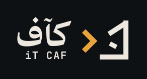
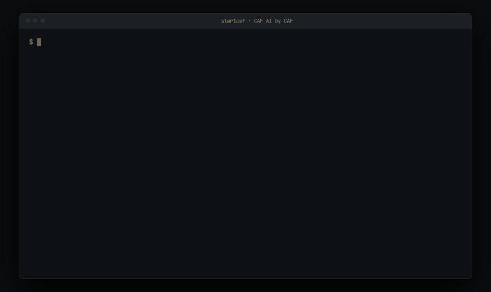
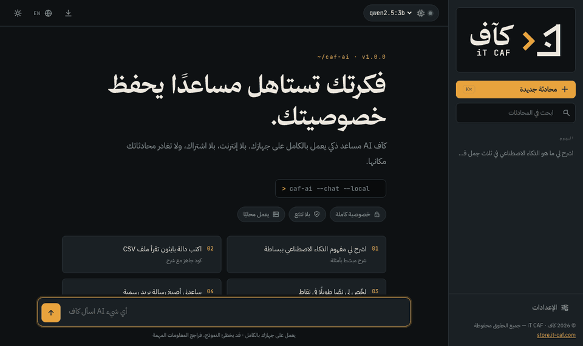
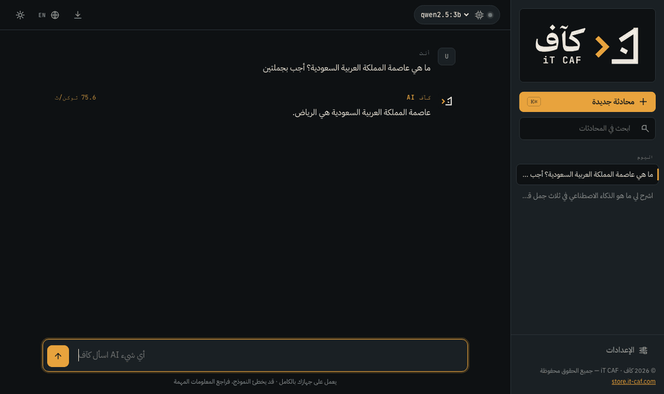

<div align="center">



# كآف AI · CAF AI

**مساعدك الذكي الخاص: يعمل على جهازك، بلا إنترنت ولا اشتراك، وبواجهة عربية كاملة.**
**Your private AI assistant: runs on your machine, no internet, no subscription, Arabic-first.**

`macOS` · `Windows` · `Linux` &nbsp;|&nbsp; [العربية](#ar) · [English](#en)



**by CAF** · [store.it-caf.com](https://store.it-caf.com)

</div>

---

<a id="ar"></a>

# العربية

## ما هو كآف AI؟

مساعد ذكاء اصطناعي يعمل بالكامل على جهازك. تكتب أمرًا واحدًا في الطرفية:

```
startcaf
```

فيشغّل كآف AI ويفتح لك الدردشة مباشرة في المتصفح على **http://127.0.0.1:3737/**.

- **خصوصية كاملة:** محادثاتك تبقى على جهازك. لا تتبّع ولا حساب ولا سحابة.
- **عربي أولًا:** واجهة RTL افتراضيًا بخطوط هوية كآف، وتبديل فوري إلى الإنجليزية.
- **ليلي ونهاري:** وضع ليلي ونهاري أو تلقائي حسب جهازك.
- **بلا إنترنت** بعد التثبيت الأول.
- **المشروع خفيف:** لا برامج ولا نماذج داخله. المحرك والنماذج تُنزَّل عند أول تشغيل إلى مجلدك الشخصي.

<div align="center">

</div>

## التثبيت

ثبّت الأمر `startcaf` مرة واحدة، ثم افتح **طرفية جديدة**.

### macOS و Linux

الصق في أي طرفية (Terminal، iTerm2، Warp، Ghostty، GNOME Terminal، Konsole، Alacritty، kitty، طرفية VS Code…):

```bash
curl -fsSL https://raw.githubusercontent.com/iT-CAF/CAF-AI/main/install-caf-ai.sh | bash
```

### Windows

الصق في **PowerShell** أو **Windows Terminal**:

```powershell
irm https://raw.githubusercontent.com/iT-CAF/CAF-AI/main/install-caf-ai.ps1 | iex
```

يعمل الأمر بعد التثبيت في PowerShell وcmd وGit Bash.

### التثبيت من ملف ZIP

فكّ الضغط ثم شغّل مرة واحدة:

| النظام | الأمر |
|---|---|
| macOS | `bash install-caf-ai.sh` (أو انقر مرتين على `install-caf-ai.command`) |
| Linux | `bash install-caf-ai.sh` |
| Windows | انقر مرتين على `install-caf-ai.bat` |

> المثبّت يضع الأمر `startcaf` في مسارك (`~/.local/bin` في macOS وLinux، و`%LOCALAPPDATA%\CAF-AI\bin` في Windows) ولا يحتاج صلاحيات مدير.

## التشغيل

```
startcaf
```

تفتح **قائمة بالأرقام** (تضغط الرقم مباشرة بدون Enter، أو الأسهم ثم Enter):

| الرقم | الوظيفة |
|---|---|
| `1` | تشغيل وفتح الدردشة في المتصفح (أو فتحها إن كان يعمل) |
| `2` | إعادة التشغيل |
| `3` | إيقاف |
| `4` | النماذج: تنزيل نموذج بالأرقام `1-5`، أو نموذج آخر `6`، أو حذف `7` |
| `5` | الإعدادات: اللغة، المظهر، التحديث، فتح مجلد البيانات، الحقوق |
| `0` | خروج (كآف AI يبقى يعمل في الخلفية) |

يعمل كآف AI في الخلفية فتبقى الطرفية حرة. في **أول تشغيل** يُنزَّل المحرك المحلي (Ollama) ثم تختار نموذجك الأول بالرقم (يوصى بـ `1` وهو `qwen2.5:7b` للعربية). تعمل الأرقام العربية ١٢٣ أيضًا.

### أوامر سريعة (بدون قائمة)

| الأمر | الوظيفة |
|---|---|
| `startcaf start` | تشغيل سريع وفتح الدردشة |
| `startcaf restart` | إعادة التشغيل |
| `startcaf stop` | إيقاف |
| `startcaf status` | الحالة |
| `startcaf models` | النماذج المثبّتة |
| `startcaf run` | تشغيل في نفس النافذة (`Ctrl+C` للإيقاف) |
| `startcaf update` | تحديث |
| `--no-open` | بدون فتح المتصفح |
| `--lang en` | لغة الطرفية: `ar` أو `en` |

## الواجهة

<div align="center">

</div>

- بث فوري للردود مع سرعة التوليد (توكن/ث).
- محادثات محفوظة مع بحث وتجميع حسب التاريخ، وتسمية وحذف.
- إعادة التوليد، نسخ الأكواد، تصدير المحادثة بصيغة Markdown.
- تعليمات نظام مخصّصة، ودرجة الإبداع، وحجم السياق.
- تنزيل النماذج وحذفها من **الإعدادات ← النماذج**.
- اختصار `⌘K` / `Ctrl+K` لمحادثة جديدة.

## متطلبات الجهاز

| النموذج | الحجم | الذاكرة الموصى بها |
|---|---|---|
| `llama3.2:3b` / `qwen2.5:3b` | ~2 GB | 4 GB |
| `gemma3:4b` | 3.3 GB | 6 GB |
| `qwen2.5:7b` (موصى به) | 4.7 GB | 8 GB |
| `qwen2.5:14b` | 9 GB | 16 GB |

يتطلب أول تشغيل اتصالًا بالإنترنت لتنزيل المحرك (حجمه من ~200 MB على macOS إلى ~1.5 GB على Linux/Windows) والنموذج. إن كان Ollama مثبّتًا عندك فسيُستخدم ولن يُنزَّل من جديد، وتُستخدم نماذجك الموجودة في `~/.ollama/models`.

## أين تُحفظ الملفات؟

كل شيء خارج مجلد المشروع:

| النظام | المجلد |
|---|---|
| macOS / Linux | `~/.caf-ai` |
| Windows | `%LOCALAPPDATA%\CAF-AI` |

يحتوي على المحرك والنماذج وبيئة Node.js المحمولة ومحادثاتك وإعداداتك. لتغيير المكان عيّن المتغير `CAF_HOME`.

## التحديث والإزالة

- **التحديث:** أعد تشغيل أمر التثبيت.
- **الإزالة:** احذف مجلد الملفات أعلاه، ثم احذف الأمر `~/.local/bin/startcaf` في macOS/Linux (وسطر `# caf-ai PATH` من ملف الطرفية). في Windows احذف المجلد ثم أزل `...\CAF-AI\bin` من متغير PATH.

## حل المشاكل

- **`startcaf: command not found`:** افتح طرفية جديدة، أو شغّل `source ~/.zshrc` (أو `~/.bashrc`).
- **العربية تظهر مقطّعة في الطرفية:** بعض الطرفيات (مثل Terminal في macOS وcmd في Windows) لا تدعم ربط الحروف العربية. استخدم iTerm2 أو Windows Terminal أو طرفية VS Code، أو شغّل `startcaf --lang en`. واجهة الدردشة في المتصفح غير متأثرة.
- **المنفذ 3737 مشغول بتطبيق آخر:** يختار كآف AI المنفذ التالي تلقائيًا ويعرضه في الطرفية.
- **Linux:** إن لزم فك ضغط المحرك ولم يتوفر `zstd` فثبّته (`sudo apt install zstd`).

## الحقوق والرخصة

**© 2026 كآف · iT CAF — by CAF. جميع الحقوق محفوظة.**
الاستخدام مجاني للأفراد والمنشآت، ولا يجوز بيع البرنامج أو إعادة توزيعه أو تعديله أو إعادة تسميته. التفاصيل في [LICENSE](LICENSE). المكوّنات الخارجية (Ollama والنماذج) لها رخصها في [NOTICES.md](NOTICES.md).

---

<a id="en"></a>
<div dir="ltr">

# English

## What is CAF AI?

An AI assistant that runs entirely on your machine. Type one command in your terminal:

```
startcaf
```

It starts CAF AI and opens the chat straight in your browser at **http://127.0.0.1:3737/**.

- **Fully private:** your chats stay on your device. No tracking, no account, no cloud.
- **Arabic-first:** RTL interface by default with the CAF brand fonts, switchable to English instantly.
- **Night & day:** dark, light, or automatic to match your system.
- **Offline** after the first setup.
- **Lightweight project:** no programs or models inside it. The engine and models are downloaded on first run into your user folder.

## Install

Install the `startcaf` command once, then open a **new terminal**.

### macOS & Linux

Paste into any terminal (Terminal, iTerm2, Warp, Ghostty, GNOME Terminal, Konsole, Alacritty, kitty, VS Code terminal…):

```bash
curl -fsSL https://raw.githubusercontent.com/iT-CAF/CAF-AI/main/install-caf-ai.sh | bash
```

### Windows

Paste into **PowerShell** or **Windows Terminal**:

```powershell
irm https://raw.githubusercontent.com/iT-CAF/CAF-AI/main/install-caf-ai.ps1 | iex
```

After installation the command works in PowerShell, cmd and Git Bash.

### Install from the ZIP

Unzip, then run once:

| OS | Command |
|---|---|
| macOS | `bash install-caf-ai.sh` (or double-click `install-caf-ai.command`) |
| Linux | `bash install-caf-ai.sh` |
| Windows | double-click `install-caf-ai.bat` |

> The installer puts `startcaf` on your PATH (`~/.local/bin` on macOS/Linux, `%LOCALAPPDATA%\CAF-AI\bin` on Windows). No administrator rights needed.

## Run

```
startcaf
```

A **numbered menu** opens (press the number directly, no Enter needed, or use arrows + Enter):

| Key | What it does |
|---|---|
| `1` | Start and open the chat in your browser (or just open it if running) |
| `2` | Restart |
| `3` | Stop |
| `4` | Models: download with `1-5`, another model `6`, delete `7` |
| `5` | Settings: language, appearance, update, open data folder, rights |
| `0` | Exit (CAF AI keeps running in the background) |

CAF AI runs in the background so your terminal stays free. On the **first run** it downloads the local engine (Ollama) and you pick your first model by number (`1` is `qwen2.5:7b`, recommended for Arabic). Arabic digits ١٢٣ work too.

### Quick commands (no menu)

| Command | What it does |
|---|---|
| `startcaf start` | Quick start and open the chat |
| `startcaf restart` | Restart |
| `startcaf stop` | Stop |
| `startcaf status` | Show status |
| `startcaf models` | Installed models |
| `startcaf run` | Run in this window (`Ctrl+C` to stop) |
| `startcaf update` | Update |
| `--no-open` | Do not open the browser |
| `--lang en` | Terminal language: `ar` or `en` |

## Interface

- Live streaming replies with generation speed (tokens/s).
- Saved chats with search, date grouping, rename and delete.
- Regenerate, copy code blocks, export a chat as Markdown.
- Custom system prompt, creativity and context size.
- Download and delete models in **Settings → Models**.
- `⌘K` / `Ctrl+K` for a new chat.

## Requirements

| Model | Size | Recommended RAM |
|---|---|---|
| `llama3.2:3b` / `qwen2.5:3b` | ~2 GB | 4 GB |
| `gemma3:4b` | 3.3 GB | 6 GB |
| `qwen2.5:7b` (recommended) | 4.7 GB | 8 GB |
| `qwen2.5:14b` | 9 GB | 16 GB |

The first run needs internet to download the engine (about 200 MB on macOS, about 1.5 GB on Linux/Windows) and a model. If Ollama is already installed it is reused and not downloaded again, and your existing models in `~/.ollama/models` are used.

## Where are the files?

Everything lives outside the project folder:

| OS | Folder |
|---|---|
| macOS / Linux | `~/.caf-ai` |
| Windows | `%LOCALAPPDATA%\CAF-AI` |

It holds the engine, models, portable Node.js, your chats and settings. Set `CAF_HOME` to move it.

## Update & uninstall

- **Update:** run the install command again.
- **Uninstall:** delete the folder above, then remove `~/.local/bin/startcaf` on macOS/Linux (and the `# caf-ai PATH` line from your shell profile). On Windows delete the folder and remove `...\CAF-AI\bin` from PATH.

## Troubleshooting

- **`startcaf: command not found`:** open a new terminal, or run `source ~/.zshrc` (or `~/.bashrc`).
- **Arabic looks disconnected in the terminal:** some terminals (macOS Terminal, Windows cmd) do not shape Arabic. Use iTerm2, Windows Terminal or the VS Code terminal, or run `startcaf --lang en`. The browser chat is not affected.
- **Port 3737 is used by another app:** CAF AI picks the next free port automatically and prints it.
- **Linux:** if the engine needs extracting and `zstd` is missing, install it (`sudo apt install zstd`).

## Rights & license

**© 2026 CAF · iT CAF — by CAF. All rights reserved.**
Free to use for individuals and organizations; selling, redistributing, modifying or rebranding is not permitted. See [LICENSE](LICENSE). Third-party components (Ollama, models) keep their own licenses in [NOTICES.md](NOTICES.md).

<div align="center">

**by CAF** · [store.it-caf.com](https://store.it-caf.com)

</div>

</div>
