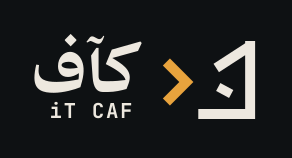
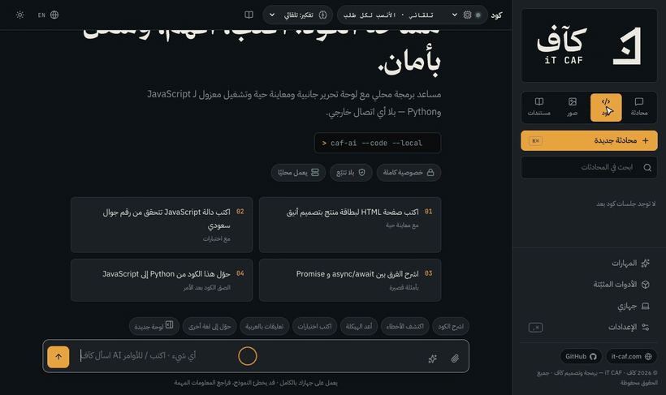
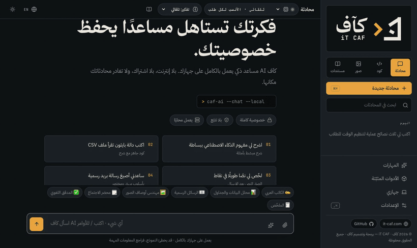
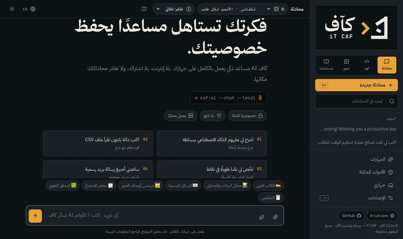
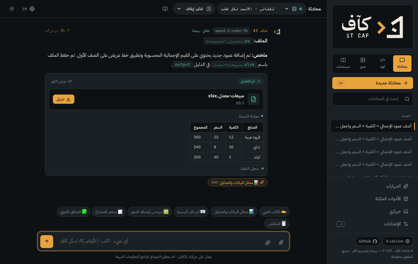

<div align="center">



# كآف AI · CAF AI — v1.2.0

**مساعدك الذكي الشامل على جهازك: محادثة، برمجة بلوحة حيّة، فهم الصور وتوليدها، مستندات، صوت، ومهارات — بلا إنترنت ولا اشتراك، وعربي أولًا.**

**Your all-in-one AI assistant on your own device: chat, live-canvas coding, image understanding & generation, documents, voice and skills — offline, no subscription, Arabic-first.**

`macOS` · `Windows` · `Linux` &nbsp;|&nbsp; Metal · CUDA · CPU &nbsp;|&nbsp; [العربية](#ar) · [English](#en)



**برمجة وتصميم كآف · by CAF** &nbsp;·&nbsp; 🌐 [**it-caf.com**](https://it-caf.com) &nbsp;·&nbsp; ⭐ [github.com/iT-CAF/CAF-AI](https://github.com/iT-CAF/CAF-AI)

</div>

---

<a id="ar"></a>

# العربية

## ما الجديد في 1.2.0؟

| | الميزة |
|---|---|
| 💬 | **محادثة أذكى:** «تلقائي» يختار النموذج الأنسب لكل طلب، تحكّم بالتفكير، وقفل اللغة (تكتب بالعربية فيرد بالعربية فقط). |
| 🧑‍💻 | **برمجة بلوحة حيّة:** اطلب برنامجًا من المحادثة أو مساحة «كود» فيُكتب كل ملف أمامك، ثم معاينة HTML وتشغيل JavaScript وPython في صندوق معزول، مع النسخ والفروق و«اطلب تعديلًا». |
| 👁️ | **فهم الصور:** أرفق صورة أو ألصقها أو اسحبها، واسأل عنها. |
| 🎨 | **توليد الصور:** على جهازك عبر stable-diffusion.cpp بنماذج FLUX.2 klein وZ-Image، أو قل «ارسم لي…». |
| 📄 | **المستندات:** PDF وWord وExcel وCSV مع المصادر، ومكتبة معرفة، وقراءة الممسوح ضوئيًا، و«عدّل عليه» لتستلم الملف معدّلًا. |
| ✨ | **المهارات و«/»:** 28 مهارة جاهزة، واستيراد مجموعات مثل Agency Agents، وعرض وتعديل وإنشاء مهاراتك. |
| 🎙️ | **الصوت (اختياري):** تحدّث واستمع — محليًا بالكامل. |
| 📦 | **تصدير ونسخ احتياطي:** Markdown وHTML وPDF، ونسخة كاملة تُستعاد بأمان. |
| 🔌 | **واجهة برمجية محلية متوافقة مع OpenAI:** على ‎127.0.0.1‎ بمفتاح محلي — [الدليل](docs/API.md). |
| 🔄 | **تحديث من داخل التطبيق:** الإعدادات ← التحديثات، مباشرة من GitHub. |
| ❓ | **صفحة التعليمات:** دليل كامل بصور متحركة من المنصة نفسها. |

<div align="center">

| المحادثة | فهم الصور |
|---|---|
|  |  |
| **المهارات و«/»** | **تعديل Excel** |
|  |  |

</div>

## التثبيت

ثبّت الأمر `startcaf` مرة واحدة، ثم افتح **طرفية جديدة**.

**macOS و Linux** — الصق في أي طرفية:

```bash
curl -fsSL https://raw.githubusercontent.com/iT-CAF/CAF-AI/main/install-caf-ai.sh | bash
```

**Windows** — الصق في PowerShell أو Windows Terminal:

```powershell
irm https://raw.githubusercontent.com/iT-CAF/CAF-AI/main/install-caf-ai.ps1 | iex
```

**من ملف ZIP:** نزّل أحدث إصدار من [صفحة الإصدارات](https://github.com/iT-CAF/CAF-AI/releases/latest)، فكّ الضغط، ثم شغّل `install-caf-ai.command` (ماك) أو `bash install-caf-ai.sh` (لينكس) أو `install-caf-ai.bat` (ويندوز).

> لا يحتاج صلاحيات مدير. المحرك والنماذج تُنزَّل عند أول تشغيل إلى مجلدك الشخصي، والمشروع نفسه لا يحتوي أي نموذج.

## التشغيل

```
startcaf
```

قائمة بالأرقام: `1` تشغيل وفتح الدردشة · `2` إعادة التشغيل · `3` إيقاف · `4` النماذج · `5` الإعدادات · `0` خروج.
يفتح المتصفح على **http://127.0.0.1:3737/** (أو المنفذ التالي إن كان مشغولًا).

| أمر سريع | الوظيفة |
|---|---|
| `startcaf start` / `stop` / `restart` / `status` | تشغيل / إيقاف / إعادة / الحالة |
| `startcaf models` | النماذج المثبّتة |
| `startcaf update` | تحديث |
| `--no-open` · `--lang en` | بدون فتح المتصفح · لغة الطرفية |

## متطلبات الجهاز

| | الحد الأدنى | الموصى به | الأفضل |
|---|---|---|---|
| الذاكرة (RAM) | 8 GB | 16 GB | 32 GB أو أكثر |
| المعالج الرسومي | غير مطلوب (CPU) | Apple Silicon (Metal) أو NVIDIA بذاكرة 6 GB+ | Apple Silicon Pro/Max أو NVIDIA بذاكرة 12 GB+ |
| مساحة القرص | 10 GB | 25 GB | 60 GB |
| النظام | macOS (Apple Silicon أو Intel) · Windows 10/11 · Linux x64/arm64 | | |
| الإنترنت | لأول تنزيل فقط | | |

### النماذج المقترحة حسب جهازك

صفحة **جهازي** تقيس جهازك وتقترح هذا تلقائيًا، وتعلّم كل نموذج بـ «مناسب» أو «بطيء» أو «أكبر من جهازك».

| جهازك | المحادثة | البرمجة | الرؤية | التضمين (البحث في المستندات) |
|---|---|---|---|---|
| 8 GB بدون GPU | `qwen3.5:2b` | `qwen2.5-coder:1.5b` | `qwen3-vl:2b` | `qwen3-embedding:0.6b` |
| 16 GB أو Apple Silicon | `qwen3.5:4b` / `qwen2.5:7b` | `qwen2.5-coder:7b` | `qwen3-vl:4b` | `qwen3-embedding:0.6b` |
| 32 GB أو GPU 12 GB+ | `qwen3.5:9b` | `qwen2.5-coder:14b` | `qwen3-vl:8b` | `qwen3-embedding:0.6b` |
| 64 GB أو GPU 24 GB+ | `qwen3.5:35b` (MoE) | `qwen3-coder:30b` (MoE) | `qwen3.5:27b` | `qwen3-embedding:0.6b` |

- **الصوت:** `gemma4:e2b` (يفهم الكلام) أو whisper.cpp. **توليد الصور:** FLUX.2 klein 4B (يحتاج ~8 GB) أو Z-Image Turbo (~10 GB).
- كل النماذج المقترحة برخص تسمح بالاستخدام التجاري (Apache-2.0 / MIT)، والتطبيق ينبّهك قبل تنزيل أي نموذج برخصة غير تجارية. التفاصيل في [NOTICES.md](NOTICES.md).

## أين تُحفظ بياناتك؟

| النظام | المجلد |
|---|---|
| macOS / Linux | `~/.caf-ai` |
| Windows | `%LOCALAPPDATA%\CAF-AI` |

المحرك والنماذج والمحادثات والإعدادات كلها هناك. لنقل كآف AI على **فلاشة USB** عيّن المتغير `CAF_HOME` إلى مسار عليها.

## الخصوصية والأمان

- يعمل بالكامل على جهازك: بلا حسابات، بلا تتبع، بلا سحابة، وبلا أي CDN في الواجهة.
- الخادم يستمع على `127.0.0.1` فقط، مع رمز جلسة وحماية من طلبات المواقع الأخرى (Host/Origin/CSP).
- لا يُنفَّذ أي أمر نظام من مخرجات النموذج إطلاقًا؛ تشغيل الكود داخل صندوق معزول في المتصفح بلا شبكة.

## التحديث والإزالة

- **التحديث:** من داخل التطبيق: **الإعدادات ← التحديثات** (يحتفظ بنسخة من الإصدار السابق)، أو `startcaf update`، أو أعد أمر التثبيت.
- **الإزالة:** احذف مجلد البيانات أعلاه ثم الأمر `~/.local/bin/startcaf` (وسطر `# caf-ai PATH`). في ويندوز احذف المجلد وأزل `...\CAF-AI\bin` من PATH.

## حل المشاكل

- **`startcaf: command not found`:** افتح طرفية جديدة أو `source ~/.zshrc`.
- **الرد بطيء:** اختر نموذجًا أصغر من «الأدوات المثبّتة»، أو قلّل حجم السياق من الإعدادات.
- **الرد يخلط لغات:** خفّض «الإبداع» (temperature) إلى 0.7 أو أقل.
- **العربية مقطّعة في الطرفية:** استخدم iTerm2 أو Windows Terminal أو `startcaf --lang en` — واجهة المتصفح غير متأثرة.
- المزيد في صفحة **التعليمات** داخل التطبيق، وخطة الاختبار في [docs/TESTING.md](docs/TESTING.md).

## للمطورين

- [docs/ARCHITECTURE.md](docs/ARCHITECTURE.md) — البنية وطبقة المزوّدين والأمان.
- [docs/API.md](docs/API.md) — الواجهة البرمجية المحلية بأمثلة curl وPHP وJavaScript وPython.
- `npm test` — الاختبارات الآلية (بلا إنترنت ولا نماذج). `npm run build:vendor` — إعادة بناء المكتبات المضمّنة.
- [CHANGELOG.md](CHANGELOG.md) — سجل التغييرات.

## الحقوق والرخصة

**© 2026 كآف · iT CAF — برمجة وتصميم كآف. جميع الحقوق محفوظة.**
الاستخدام مجاني للأفراد والمنشآت، ولا يجوز بيع البرنامج أو إعادة توزيعه أو تعديله أو إعادة تسميته. التفاصيل في [LICENSE](LICENSE). المكوّنات الخارجية (Ollama والنماذج والمكتبات) لها رخصها في [NOTICES.md](NOTICES.md).

**اكتشف منصة iT CAF:** 🌐 [**it-caf.com**](https://it-caf.com) — كاف بايو لإدارة نشاطك التجاري: نقاط الولاء، بطاقات Apple وGoogle Wallet، الحجوزات، الطلبات، وصفحة البايو.

---

<a id="en"></a>
<div dir="ltr">

# English

## What's new in 1.2.0

| | Feature |
|---|---|
| 💬 | **Smarter chat:** “Auto” picks the best model per request, thinking control, and a language lock (write Arabic, get Arabic only). |
| 🧑‍💻 | **Live-canvas coding:** ask from chat or the Code workspace and every file is written in front of you; HTML preview and sandboxed JavaScript/Python runs, with versions, diffs and “Ask for an edit”. |
| 👁️ | **Image understanding:** attach, paste or drop an image and ask about it. |
| 🎨 | **Image generation:** on your device with stable-diffusion.cpp and FLUX.2 klein / Z-Image, or just say “draw me…”. |
| 📄 | **Documents:** PDF, Word, Excel and CSV with sources, a knowledge library, OCR for scans, and “edit it” to get the edited file back. |
| ✨ | **Skills & “/”:** 28 ready skills, import collections such as Agency Agents, and view, edit or create your own. |
| 🎙️ | **Voice (optional):** speak and listen — fully local. |
| 📦 | **Export & backup:** Markdown, HTML and PDF, plus a full backup you can restore safely. |
| 🔌 | **Local OpenAI-compatible API:** on 127.0.0.1 with a local key — [guide](docs/API.md). |
| 🔄 | **In-app updates:** Settings → Updates, straight from GitHub. |
| ❓ | **Help page:** a complete guide with animated captures of the app itself. |

## Install

Install the `startcaf` command once, then open a **new terminal**.

```bash
# macOS & Linux
curl -fsSL https://raw.githubusercontent.com/iT-CAF/CAF-AI/main/install-caf-ai.sh | bash
```

```powershell
# Windows (PowerShell / Windows Terminal)
irm https://raw.githubusercontent.com/iT-CAF/CAF-AI/main/install-caf-ai.ps1 | iex
```

**From the ZIP:** download the latest from [Releases](https://github.com/iT-CAF/CAF-AI/releases/latest), unzip, then run `install-caf-ai.command` (macOS), `bash install-caf-ai.sh` (Linux) or `install-caf-ai.bat` (Windows).

> No admin rights needed. The engine and models download on first run into your user folder; the project itself contains no models.

## Run

```
startcaf
```

Numbered menu: `1` start & open chat · `2` restart · `3` stop · `4` models · `5` settings · `0` exit.
Opens **http://127.0.0.1:3737/** (or the next free port).

| Quick command | Does |
|---|---|
| `startcaf start` / `stop` / `restart` / `status` | start / stop / restart / status |
| `startcaf models` | installed models |
| `startcaf update` | update |
| `--no-open` · `--lang en` | don't open the browser · terminal language |

## Requirements

| | Minimum | Recommended | Best |
|---|---|---|---|
| Memory (RAM) | 8 GB | 16 GB | 32 GB+ |
| GPU | not required (CPU) | Apple Silicon (Metal) or NVIDIA 6 GB+ | Apple Silicon Pro/Max or NVIDIA 12 GB+ |
| Disk | 10 GB | 25 GB | 60 GB |
| OS | macOS (Apple Silicon or Intel) · Windows 10/11 · Linux x64/arm64 | | |
| Internet | first download only | | |

### Recommended models by device

The **My device** page measures your machine, suggests these automatically, and marks every model as “fits”, “slow” or “too big”.

| Your device | Chat | Code | Vision | Embeddings |
|---|---|---|---|---|
| 8 GB, no GPU | `qwen3.5:2b` | `qwen2.5-coder:1.5b` | `qwen3-vl:2b` | `qwen3-embedding:0.6b` |
| 16 GB or Apple Silicon | `qwen3.5:4b` / `qwen2.5:7b` | `qwen2.5-coder:7b` | `qwen3-vl:4b` | `qwen3-embedding:0.6b` |
| 32 GB or 12 GB+ GPU | `qwen3.5:9b` | `qwen2.5-coder:14b` | `qwen3-vl:8b` | `qwen3-embedding:0.6b` |
| 64 GB or 24 GB+ GPU | `qwen3.5:35b` (MoE) | `qwen3-coder:30b` (MoE) | `qwen3.5:27b` | `qwen3-embedding:0.6b` |

- **Voice:** `gemma4:e2b` (understands speech) or whisper.cpp. **Image generation:** FLUX.2 klein 4B (~8 GB) or Z-Image Turbo (~10 GB).
- All recommended models are commercially usable (Apache-2.0 / MIT); the app warns before downloading anything non-commercial. Details in [NOTICES.md](NOTICES.md).

## Where is my data?

`~/.caf-ai` on macOS/Linux, `%LOCALAPPDATA%\CAF-AI` on Windows — engine, models, chats and settings. Set `CAF_HOME` to run from a **USB drive**.

## Privacy & security

- Runs entirely on your device: no accounts, no tracking, no cloud, no CDN in the UI.
- The server listens on `127.0.0.1` only, with a session token and protection against other websites (Host/Origin/CSP).
- No system command is ever executed from model output; code runs in an isolated, network-less browser sandbox.

## Update & uninstall

- **Update:** inside the app — **Settings → Updates** (keeps a copy of the previous version) — or `startcaf update`, or re-run the install command.
- **Uninstall:** delete the data folder above and `~/.local/bin/startcaf` (plus the `# caf-ai PATH` line). On Windows delete the folder and remove `...\CAF-AI\bin` from PATH.

## Developers

[ARCHITECTURE](docs/ARCHITECTURE.md) · [Local API](docs/API.md) · [Testing](docs/TESTING.md) · [Changelog](CHANGELOG.md) · `npm test` · `npm run build:vendor`

## Rights & license

**© 2026 CAF · iT CAF — designed & built by CAF. All rights reserved.**
Free to use for individuals and businesses; selling, redistributing, modifying or rebranding is not allowed. See [LICENSE](LICENSE). Third-party components (Ollama, models, libraries) keep their own licenses — see [NOTICES.md](NOTICES.md).

**Discover the iT CAF platform:** 🌐 [**it-caf.com**](https://it-caf.com) — CAF BiO for running your business: loyalty points, Apple & Google Wallet cards, bookings, orders and a bio page.

</div>
